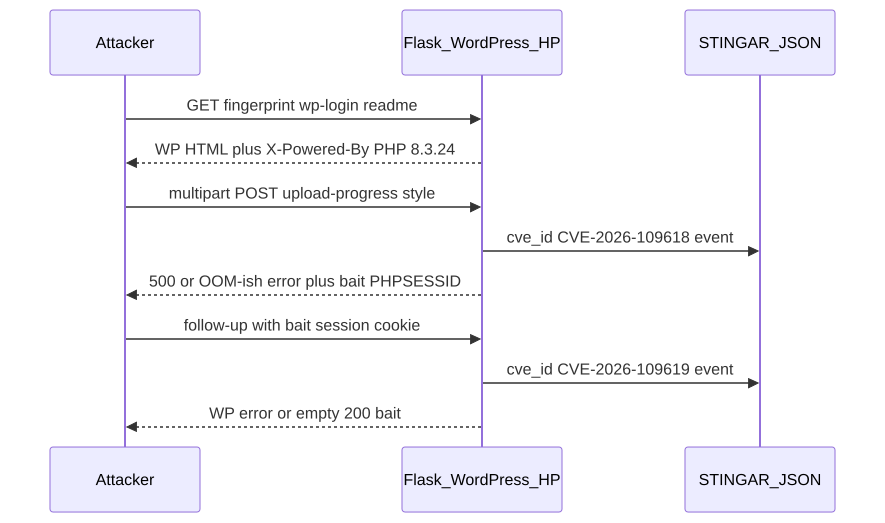
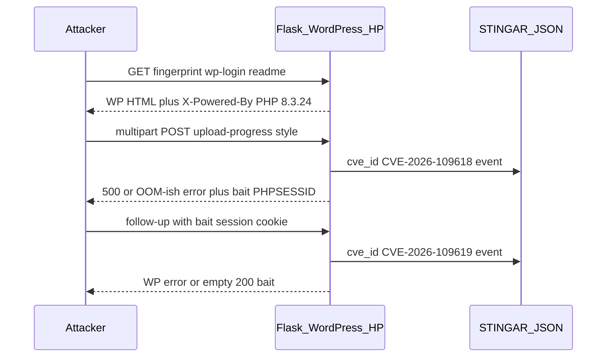

# WordPress PHP2Shell Honeypot

Behavioral bait for **PHP2Shell** (**CVE-2026-109618** and **CVE-2026-109619**) on a WordPress / Apache / unpatched PHP fingerprint.

## What this is

A Flask honeypot that looks like a public WordPress site running **PHP/8.3.24** (unpatched relative to the 2026-10-21 security release). It captures probe-shaped traffic associated with PHP2Shell and emits per-CVE log events for STINGAR / JSON consumers.

It does **not** run a vulnerable PHP engine and does **not** execute attacker payloads.

## Probe flow

## CVEs

| CVE | Role in honeypot |
|---|---|
| CVE-2026-109618 | Multipart / upload-progress style POSTs to WordPress entrypoints; returns OOM-style PHP fatal HTML and issues a bait `PHPSESSID` |
| CVE-2026-109619 | Follow-up requests that replay the bait `PHPSESSID`; returns fatal-error style HTML |

## Fingerprint

- `Server: Apache/2.4.58 (Unix)`
- `X-Powered-By: PHP/8.3.24`
- WordPress home, login, admin, xmlrpc, readme, version stub

## Logging

When a probe matches, events include `cve_id`, method, path, content-type, body size, and whether a bait `PHPSESSID` was issued or replayed.
